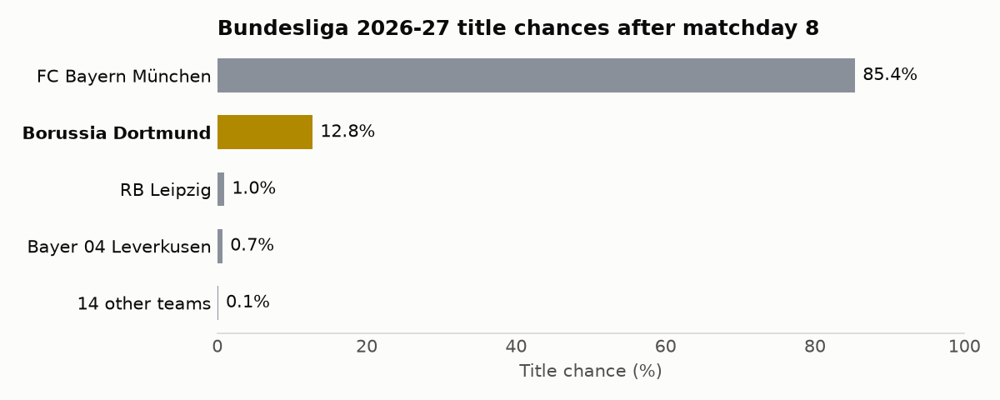
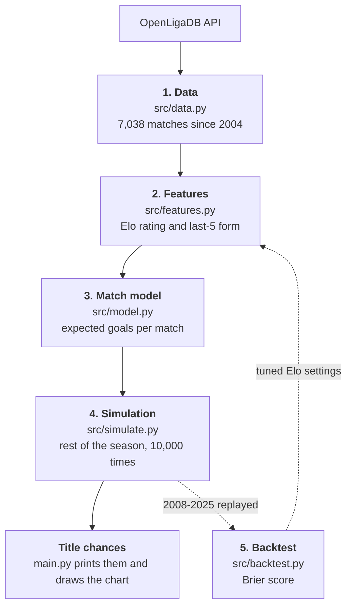

# ML Borussia Dortmund Bundesliga Predictor

Echte Liebe! 🖤💛

This project is an end-to-end machine learning pipeline that predicts whether Borussia Dortmund will win the Bundesliga title, using historical team data and live mid-season stats from the OpenLigaDB API.



## Current prediction

After matchday 8 of 2026-27, BVB has about a **13%** chance of winning the title.
Bayern has about 85%.
Both teams have 18 points, but Bayern has the better goal difference and a much higher Elo rating.

The numbers move by a few tenths of a percent between runs, because the simulation is random.

## How it works



1. **Data**: `src/data.py` downloads every Bundesliga match since 2004 from [OpenLigaDB](https://www.openligadb.de) and caches each season as a CSV file.
2. **Features**: `src/features.py` gives every match two numbers per team, from before kickoff only:
   - **Elo rating**: long-term strength that goes up when a team beats expectations.
   - **Form**: average points over the last 5 matches.
3. **Match model**: `src/model.py` fits two Poisson regressions that predict the expected goals for the home team and the away team.
4. **Simulation**: `src/simulate.py` plays every remaining match 10,000 times with random scores from the match model, and counts how often each team finishes first.
5. **Backtest**: `src/backtest.py` predicts every past season from 2008 to 2025 using only what was known at the time, and tunes the Elo settings.

The approach is a match model plus a simulation, not one classifier per team-season.
Only 1 of 18 teams wins the title each year, so there are too few winners to learn from, while there are 7,000 matches.
The simulation also plays out the fixtures BVB actually has left, including both matches against Bayern.

## How good it is

The backtest scores each prediction with the [Brier score](https://en.wikipedia.org/wiki/Brier_score): 0 is 100% on the real champion, 2 is 100% on the wrong team.
The baseline gives 100% to the current leader, or to last season's champion at matchday 0.

| Matchday | Model | Baseline |
|---|---|---|
| 0 | **0.42** | 0.67 |
| 9 | **0.30** | 0.89 |
| 17 | **0.29** | 0.56 |
| 25 | **0.08** | 0.22 |

- The model beats the baseline at every point in the season.
- Its percentages are mostly honest: predictions of about 13% came true 13% of the time, and predictions of about 85% came true 90% of the time.
- On goals, it is about 10% better than always predicting the league average, and it picks the right result (win, draw or loss) 52% of the time.

### Prediction history

This is what the model predicted at the halfway point (matchday 17) of every season, using only the first half of that season and the seasons before it.
Its favourite won 15 of the 18 titles.
A miss means another team was the favourite.

| Season | Champion | Model at halfway |
|---|---|---|
| 2008-09 | Wolfsburg | 0% (miss) |
| 2009-10 | Bayern | 51% |
| 2010-11 | **BVB** | **95%** |
| 2011-12 | **BVB** | **29%** (miss) |
| 2012-13 | Bayern | 96% |
| 2013-14 | Bayern | 100% |
| 2014-15 | Bayern | 100% |
| 2015-16 | Bayern | 99% |
| 2016-17 | Bayern | 99% |
| 2017-18 | Bayern | 100% |
| 2018-19 | Bayern | 52% |
| 2019-20 | Bayern | 48% |
| 2020-21 | Bayern | 95% |
| 2021-22 | Bayern | 99% |
| 2022-23 | Bayern | 87% |
| 2023-24 | Leverkusen | 23% (miss) |
| 2024-25 | Bayern | 73% |
| 2025-26 | Bayern | 100% |

## Run it

You need Python 3.10 or later.

1. Clone the repository and set up a virtual environment:

   ```bash
   git clone https://github.com/biancacchino/bvb-title-predictor.git
   cd bvb-title-predictor
   python3 -m venv .venv
   source .venv/bin/activate
   pip install -r requirements.txt
   ```

2. Run the prediction:

   ```bash
   python main.py
   ```

   It prints BVB's title chance and the top 5, and saves the chart to `docs/title_chances.png`.
   The first run downloads every season, so it takes about 20 seconds.
   Later runs only download the current season.

3. Optional: run the tests and the backtest:

   ```bash
   pytest
   python -c "from src.data import load_all; from src.backtest import title_backtest; print(title_backtest(load_all()).groupby('cutoff_matchday')[['brier', 'baseline_brier']].mean())"
   ```

## Project structure

- `main.py`: runs the prediction and draws the chart.
- `src/`: data, features, match model, simulation and backtest.
- `tests/`: pytest tests for every step.
- `notebooks/exploration.ipynb`: where each step was explored before moving into `src/`.

## Limitations

- **No transfers**: the model only knows results, so a star signing shows up only after a few matches. Early-season predictions are the weakest.
- **Frozen ratings**: ratings don't change inside a simulated season, so the chances are probably a bit too confident.
- **Too few draws**: the match model predicts about 22% draws, while the real rate is about 25%.
- **Partial tiebreaks**: ties are broken by points, goal difference and goals scored. Head-to-head is skipped.
- **History starts in 2004**: OpenLigaDB only has results for 20 of the 306 matches in 2003.

## Credits

Match data from [OpenLigaDB](https://www.openligadb.de).
